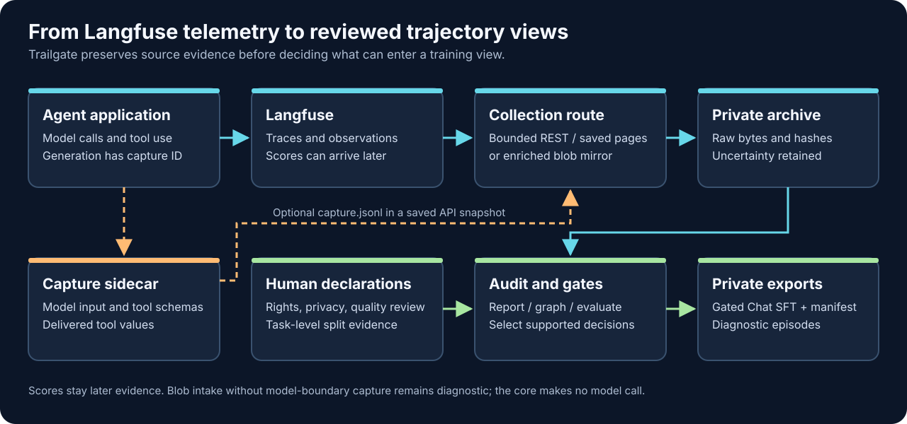

# Trailgate

**Collect, audit, and prepare agent trajectories from Langfuse with explicit provenance and training gates.**

Trailgate is a local-first Python CLI and library. It imports saved Langfuse Observations v2 / Scores v3 pages, can pull bounded pages through the read-only API, and ingests complete enriched blob-export runs. It preserves source bytes and hashes, reconstructs observed decision/tool relationships, and separates capture fidelity from quality, rights, privacy, and split decisions. The core never calls a model or uploads a dataset.

[日本語 README](README.ja.md) · [End-to-end guide](docs/GUIDE.md) · [v1 contracts](docs/CONTRACT.md) · [Roadmap](docs/ROADMAP.md) · [Release checklist](docs/RELEASING.md)



Langfuse supplies observations and later scores; application-side capture supplies the exact model-boundary messages and delivered tool values. Trailgate keeps both as private source evidence before auditing and exporting. See [trajectory format choices](docs/FORMATS.md) for the distinction between its archival format and training views.

## Try the fictional fixture

CPython 3.12.13–3.14 is supported; `.python-version` selects 3.12.13 for the locked development environment. From a fresh checkout:

```sh
uv sync --locked
uv run --locked trailgate doctor --source langfuse --input examples/synthetic/snapshot
uv run --locked trailgate ingest langfuse-api-snapshot examples/synthetic/snapshot --out private-example
uv run --locked trailgate report private-example
uv run --locked trailgate export graph private-example --out private-graph.json
uv run --locked trailgate evaluate dataset private-example \
  --rights-file examples/synthetic/rights.json \
  --policy-file examples/synthetic/policy.json \
  --use internal_training
uv run --locked trailgate export dataset private-example \
  --rights-file examples/synthetic/rights.json \
  --policy-file examples/synthetic/policy.json \
  --use internal_training --out private-dataset
```

The synthetic fixture contains two Chat SFT decisions. The sample rights and policy files apply only to this exact fictional snapshot ID. `private-*` outputs are ignored by Git; on POSIX hosts archive and dataset directories use mode `0700`, and files use `0600`. Existing outputs are never overwritten.

`trailgate export sft` remains a **candidate-only diagnostic** for compatibility. It does not apply quality, privacy, or split gates. `evaluate dataset` previews gate counts and reasons without writing model content; `export dataset` creates the gated training view. See [dataset eligibility](docs/DATASET.md).

## Inputs and outputs

| Input path | Current operation | Details |
|---|---|---|
| Saved Observations v2 / Scores v3 response pages | `doctor`, `ingest langfuse-api-snapshot` | [Snapshot format](#saved-api-snapshot) |
| Live read-only Langfuse API | `pull langfuse` | [Bounded pull and resume](docs/PULL.md) |
| Mirrored enriched blob-export run | `ingest-blob` | [Manifest-based streaming import](docs/BLOB.md) |
| Application model boundary | `CaptureWriter` | [Capture, abort, and recovery](docs/CAPTURE.md) |

`report` prints counts and at most 100 decision diagnostics by default (`--max-decisions`, maximum 1,000). It never prints captured prompt or tool-result content. `export graph` writes a private [versioned episode graph](docs/EPISODE_GRAPH.md) with captured content and explicit unknown boundaries. `export dataset` writes private generic episodes, gated Chat SFT rows, and a manifest with hashes and selection reasons. Scores are linked to subjects as evidence and never inserted into earlier model input. The [published JSON Schemas](docs/CONTRACT.md#published-json-schemas) cover public file envelopes; runtime checks also verify hashes and cross-file relationships.

Saved API snapshots are limited to 64 MiB. In-memory graph, audit, and dataset views accept at most 20,000 observations and 32 MiB of normalized rows plus capture. Bulk `report` and `inspect` stream verified rows; `inspect` reports omitted observations when its output limit is reached. See [bulk intake](docs/BLOB.md) for larger collections.

### Saved API snapshot

The input directory contains `manifest.json`, `observations.jsonl`, and `scores.jsonl`; `capture.jsonl` is optional. The JSONL files hold one saved API response page per line, with `data` and `meta.cursor`. The last page must have a null cursor. The manifest declares API versions, selected field groups, bounded timezone-aware query ranges, and `complete: true`. Trailgate checks page syntax, core fields, cursor progression, row IDs, time ranges, and source hashes. This declaration does not prove that the source collector saw every trace or a late-arriving score.

Langfuse observations alone do not prove the exact messages or tool schemas sent to a model. For faithful decisions, the application records those at the model boundary and links a capture ID to the generation. The [capture guide](docs/CAPTURE.md) explains the contract. See Langfuse's [public API](https://langfuse.com/docs/api-and-data-platform/features/public-api) and [blob-export documentation](https://langfuse.com/docs/api-and-data-platform/features/export-to-blob-storage) for source behavior.

## What the gates mean

`faithful_candidates` is a **structural capture count**, not a correctness or rights judgment. The current Chat SFT projection supports text and function calls; multimodal parts, legacy function calls, and provider-specific Chat fields are excluded. Provider-native Responses data stays opaque in the private archive and generic episode view. The tool envelope is checked, but full JSON Schema semantics and model-specific chat templates are outside this release.

The dataset view requires manually selected generation IDs, separate use attestations for task input/model output/tool result, an explicit privacy review with no sensitive content, trace-to-task split evidence, and consistent session IDs across each trace. These are self-attestations: Trailgate cannot independently certify answer quality, legal permission, privacy, or that the application captured at the correct instant. Automatic redaction, exact episode boundaries, multi-source log ingestion, token-level loss masks, preference/RL rollout export, and model training remain outside v1.0.0. See the [threat model](docs/SECURITY.md) and [comparison](docs/COMPARISON.md).

Optional [live diagnostics](examples/live/README.md) use a self-hosted Langfuse instance and, only when explicitly run, a model API or official MuSiQue train corpus. Tests and the core package use fictional data and make no model calls.

## Development

```sh
uv run --locked ruff check src tests examples scripts
uv run --locked ruff format --check src tests examples scripts
uv run --locked python -m unittest discover -s tests -q
uv run --locked --extra bulk-parquet python -m unittest discover -s tests -q
uv build
uv run --locked python scripts/check_release_artifacts.py
uv run --locked python scripts/check_public_files.py
uv run --locked python scripts/benchmark_bulk.py --rows 100000
```

Do not add credential files, private archives, real trajectories, or corpus text to Git. The public-file check is a guardrail, not a guarantee that all sensitive content was detected.

MIT licensed. See [LICENSE](LICENSE).
